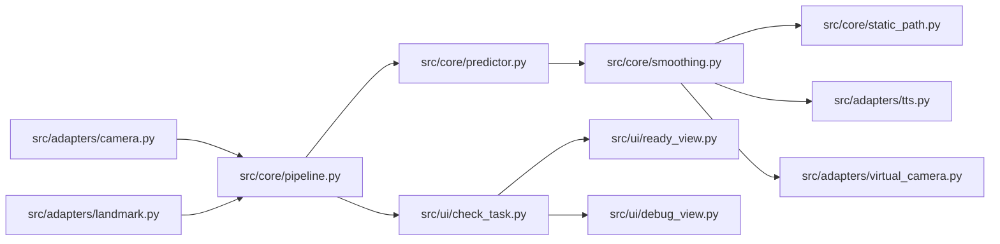

# TECH_STACK — IsyaratKu Cam

Latest. Phase 1 DISCOVER, 2026-10-16. Verified by reading the files named, not from memory.

## Runtime

| Layer | Choice | Evidence |
| --- | --- | --- |
| Language | Python 3.14.6 | docs/AGENTS.md:81; docs/environment.md:69 |
| Package manager | `pip` 26.1.2, no virtualenv, global interpreter | docs/AGENTS.md:81 |
| GUI | PySide6 6.11.2 (Qt6) | requirements.txt |
| Vision | OpenCV 5.0.0.93, MediaPipe 1.0.1 | requirements.txt |
| Numerics | NumPy 2.5.3 | requirements.txt |
| Virtual camera | pyvirtualcam 0.15.0 | requirements.txt |
| Audio out | sounddevice 0.5.6 | requirements.txt |
| TTS engine | piper-tts 1.8.0 (library, not subprocess) | `from piper import PiperVoice` src/adapters/tts.py:48; docs/tech-decisions.md:218 |
| Tests | pytest 9.1.1 | requirements.txt |

**Dependency defect (in scope, B2):** `requirements.txt` pins `pyttsx3==2.99`,
imported nowhere, and omits `piper`, which is imported at src/adapters/tts.py:48.

## Architecture



Dependency direction is one-way: `ui -> core <- adapters` (docs/AGENTS.md).
`src/core/` is pure logic with no side effects and imports no UI, camera, or GUI
library. Every hardware touchpoint has a `Fake*` counterpart so the whole pipeline
runs headless.

## Layout

| Path | Role | Git? |
| --- | --- | --- |
| `src/core/` | Pure logic: normalisation, windowing, smoothing, prediction, pipeline assembly | yes |
| `src/adapters/` | Everything touching the outside world: camera, MediaPipe, virtual camera, audio/TTS, classifiers | yes |
| `src/ui/` | Ready-to-use and debug views | yes |
| `training/` | Landmark extraction, training, evaluation — not used at runtime | yes |
| `models/` | Trained artifacts used by the app | yes, except `models/tts/` |
| `data/` | Raw dataset and extracted features | **no** (git-ignored) |
| `configs/` | Tunable parameters | yes |
| `tests/` | pytest suite using fake adapters | yes |
| `docs/` | Project contract: goals, decisions, architecture, dataset notes, plan | yes |
| `specs/` | Cockpit for this initiative (state, plan, epics) | yes |

## Data pipeline

```mermaid
graph LR
  RAW[data/raw/&#42;.mp4] -->|"python -m training.extract"| NPZ[data/extracted/&#42;.npz]
  NPZ -->|"training.dataset"| SPLIT["split: train s0-2 / val s4 / test s3"]
  SPLIT -->|"training/train.py"| JOBLIB[models/&#42;.joblib]
  JOBLIB -->|"training/export_numpy.py"| MODELS[models/&#42;.npz]
  MODELS --> RUNTIME[src/adapters/predictor.py]
```



Split is by **signer**, never by sample: train signer 0-2, val signer 4, test
signer 3 (`training/dataset.py:117` `DEFAULT_SPLIT`). This is the hard rule that
makes the reported numbers mean anything at all.

## Verified dataset state (2026-10-16)

| Fact | Value | How verified |
| --- | --- | --- |
| `data/raw/wl-bisindo.zip` entries | 1600 (all `.mp4`) | `zipfile.ZipFile(...).namelist()` |
| `data/raw/wl-bisindo/` on disk | 1155 `.mp4` | `glob('*.mp4')` |
| `data/raw/pilih75/` on disk | 446 `.mp4` + `manifest.csv` | `glob('*.mp4')` |
| zip entries missing from `wl-bisindo/` | 445 | set difference |
| of those, present in `pilih75/` | 445 | set intersection |
| unaccounted | 0 | set difference |
| `data/extracted/*.npz` (root) | 1600 | `glob('*.npz')` |
| `data/extracted/demo3/*.npz` | 200 | `glob('*.npz')` |
| zip ids never extracted | 0 | set difference |
| `data/self/` | empty | `find` |

**Consequence:** `training/extract.py:49` points the documented command at
`data/raw/wl-bisindo`, which holds 1155 of 1600 videos. The complete npz set exists
today only because `pilih75` was extracted in a separate run. The documented
command is therefore not reproducible from the documented layout.

## Tooling gaps

- No `pyproject.toml`, no `pytest.ini`, no `setup.cfg`: no declared test paths, no
  lint config, no project metadata.
- No linter or type checker configured.

## Verification commands

```bash
python -m src.ui.app --headless --seconds 3     # full pipeline, fake adapters, no hardware
python -m pytest -q -p no:cacheprovider          # documented suite command
python -m training.dataset                       # split and per-label window counts
python -m training.extract --source DIR          # landmark extraction (idempotent)
```
